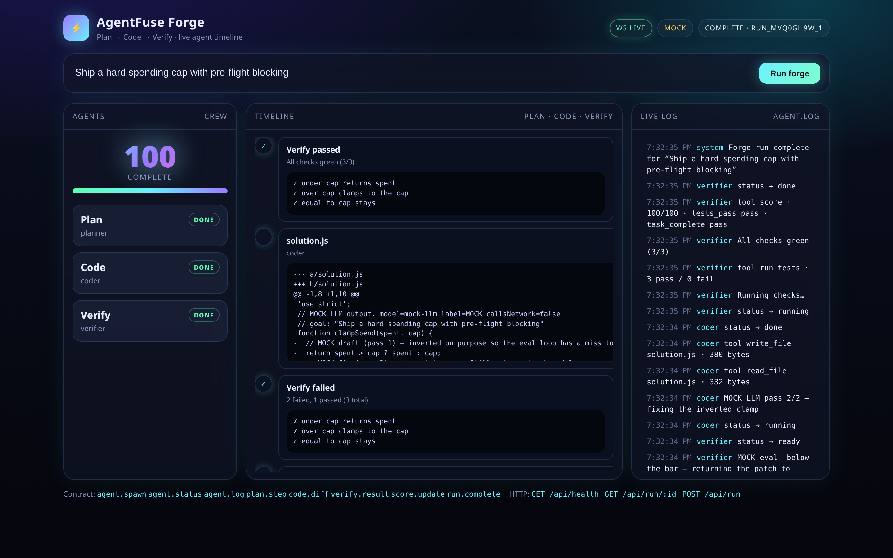

<h1 align="center">⚡ agentfuse</h1>
<p align="center"><b>A hard spending cap and kill switch for AI coding agents.</b><br>
Put a dollar limit on Claude Code, Codex, Gemini CLI, Aider or your own agent.<br>
The fuse blows <i>before</i> the request that would cross the limit is sent.</p>

<p align="center">
<a href="https://github.com/barood-labs/agentfuse/actions/workflows/ci.yml"></a>

= 18.17">

</p>

<p align="center">


</p>

## 🔥 Forge — watch agents plan, code, and verify live

Neon glass dashboard for a real local multi-agent loop: **Planner → Coder → Verifier**. They share tools (`read_file` · `write_file` · `run_tests` · `score`), miss on purpose, then fix until the rubric hits **100**. Model is labeled **MOCK** — no API key, no network, **$0**. The spend-cap proxy below is unchanged.

```bash
npm install && npm run forge   # → http://localhost:8787/  click “Run forge”
```

<p align="center"><br>
<sub><b>Live Forge run:</b> WebSocket timeline + agent cards + score flourish. Deterministic mock-llm, score <b>100</b>.</sub></p>

**Contract the UI speaks**

- **WS** `agent.spawn` · `agent.status` · `agent.log` · `plan.step` · `code.diff` · `verify.result` · `score.update` · `run.complete`
- **HTTP** `GET /api/health` · `GET /api/run/:id` · `POST /api/run` `{ "goal": "…" }`
- **UI** `/` (also `/ui`) from `public/` · fields in [`forge/CONTRACT.md`](forge/CONTRACT.md)

---

```bash
npx github:barood-labs/agentfuse --cap 5 -- claude
```

<p align="center"><br>
<sub><b>Simulated demo:</b> real agentfuse output, running a looping agent against a local mock API (<code>npm run demo</code>). $0 was spent.</sub></p>

> **Not on npm yet.** The `agentfuse` name on npm belongs to an unrelated placeholder package, so **don't install it by that bare name**. Use `npx github:barood-labs/agentfuse`, which installs straight from this repo.

Agents loop. They retry a flaky test 40 times, re-read a 200k-token repo every turn, or get left running overnight. Usage dashboards show you the damage **afterwards**. agentfuse sits between the agent and the API and **stops it at the number you picked**.

## Features

- 💵 **Hard caps** per session, per day and per repo: `--cap 5 --daily 20 --repo-cap 10`. `--cap` defaults to **$5** if you don't set it.
- 🛑 **Pre-flight blocking.** Before forwarding a request, agentfuse estimates what it will cost from the previous turn on that model, or from the prompt size on the first turn. If the request would cross the cap, it's refused, so a normal agent loop stops *under* the limit. In the demo, a $1 cap stopped at $0.89.
- ✂️ **Live stream cut-off.** Real APIs report output tokens only at the end of a stream, so agentfuse also counts streamed text, tool-call and thinking characters (≈4 per token) as they arrive. If that estimate crosses the cap, the stream is cut on the spot, and the cut stream is billed at the estimate.
- ⚠️ **Warn, then act.** It warns at 80% (`--warn`). At 100% it does whatever `--on-cap` says:
  - `kill` (default) stops the agent and exits with **86**.
  - `pause` holds every model call until you run `agentfuse raise 5`.
  - `block` returns the provider's own error shape with HTTP 402 and leaves the agent running.
- 🧮 **Careful pricing:**
  - Prompt-cache reads, 5-minute writes and **1-hour writes (2×)** are priced separately.
  - Long-context tiers (Sonnet 4/4.5 above 200k, Gemini 2.5 Pro above 200k, Haiku 5.5 above 100k) apply to the whole request.
  - OpenAI `cached_tokens` aren't double-counted, and Gemini thinking tokens are billed as output.
  - **OpenRouter's own reported `cost`** is used when it's there.
- 🔒 **Fails expensive, not cheap:**
  - Unknown models and *newer versions of known models* (e.g. `claude-opus-4-9`) are billed at a high fallback rate ($15/$75) and flagged.
  - Aborted streams are billed at the estimate instead of being dropped.
  - Parallel requests (subagents) are each tracked separately.
- 📟 **Live meter** in your terminal and in the window title (`⚡ $1.23 / $5.00 (25%)`), so it stays visible while the agent's own TUI runs.
- 🧾 **Receipts and a ledger.** A JSON receipt per session, the ledger at `~/.agentfuse/ledger.jsonl`, and `agentfuse report` to break spend down by model and by repo.
- 🪶 **Zero dependencies**, about 800 lines of Node, local only.


## Forge deep dive

Same loop as the hero above — details for contributors.

They share a tool registry (`read_file`, `write_file`, `run_tests`, `score`). The planner pins a `node:test` file. The coder's first patch fails it on purpose, the verifier scores the miss, and the coder fixes it. Rubric: **tests pass (60) + task complete (40)** → clean run **100**.

```bash
npm install          # typescript compiles the forge. The proxy runtime still has zero dependencies.
npm run forge        # http://localhost:8787/  — click “Run forge”
```

```bash
curl -s http://localhost:8787/api/health
curl -s -X POST http://localhost:8787/api/run \
  -H 'content-type: application/json' \
  -d '{"goal":"Ship a hard spending cap with pre-flight blocking"}'
```

`GET /api/run/:id` returns the run and its event log. A goal containing the words `fail` or `broken` stays red so the verifier card can be shown in the error state.

Files: `public/` (neon UI) · `forge/src` (loop, tools, MOCK LLM) · `forge/ws-lite.mjs` (zero-dep WebSocket) · `docs/forge-dashboard.png` (README hero).


## Install

```bash
npx github:barood-labs/agentfuse --help         # run without installing
npm i -g github:barood-labs/agentfuse           # puts `agentfuse` on your PATH
```

Requires Node 18.17 or newer.

## Use

```bash
agentfuse --cap 2 -- claude                     # Claude Code (API-key billing)
agentfuse --cap 5 --on-cap pause -- codex       # Codex CLI (API-key mode)
agentfuse --cap 1 -- gemini                     # Gemini CLI
agentfuse --cap 1 -- aider --model sonnet       # anything that honours *_BASE_URL
agentfuse --cap 3 --daily 15 -- python agent.py # your own agent (Anthropic / OpenAI / Gemini SDKs)

agentfuse status          # live state of running sessions
agentfuse raise 5         # add $5 to the newest running session (un-pauses it)
agentfuse report --days 7 # spend by model and by repo
agentfuse serve --cap 10  # proxy only; prints the env vars to export
```

### Supported routes

| Route | Wire format | Env var set for the child |
|---|---|---|
| `/anthropic/*` | Anthropic Messages (JSON and SSE) | `ANTHROPIC_BASE_URL` |
| `/openai/*` | OpenAI Chat Completions and Responses (JSON and SSE) | `OPENAI_BASE_URL`, `OPENAI_API_BASE` |
| `/gemini/*` | Gemini `generateContent` / `streamGenerateContent` | `GOOGLE_GEMINI_BASE_URL` |
| `/openrouter/*` | OpenAI format plus OpenRouter's reported cost | `OPENROUTER_BASE_URL` |

**Already using a gateway?** If `OPENAI_BASE_URL` (for example OpenRouter, Groq or Ollama), `ANTHROPIC_BASE_URL`, `GOOGLE_GEMINI_BASE_URL` or `OPENROUTER_BASE_URL` is already set, agentfuse uses it as the upstream, chains through it, and prints that it did. To force a specific upstream, set `AGENTFUSE_ANTHROPIC_UPSTREAM`, `AGENTFUSE_OPENAI_UPSTREAM`, `AGENTFUSE_GEMINI_UPSTREAM` or `AGENTFUSE_OPENROUTER_UPSTREAM`.

### Agent compatibility (be honest with yourself)

| Agent | How it's routed | Notes | Tested against the real API? |
|---|---|---|---|
| Claude Code | `ANTHROPIC_BASE_URL` | With a Pro/Max **subscription** you don't pay per token, so the $ shown is notional | not yet |
| Codex CLI | `OPENAI_BASE_URL` | Only in **API-key** mode. Signed in with ChatGPT, it talks to the ChatGPT backend and bypasses the proxy | not yet |
| Gemini CLI | `GOOGLE_GEMINI_BASE_URL` | API-key auth | not yet |
| Aider / Anthropic / OpenAI / Gemini SDKs | standard base-URL env vars | | not yet |
| Mock API (CI) | all four routes | 32 tests, including streams that report usage only at the end | ✅ |

The CI suite exercises every wire format against a mock that behaves like the real APIs. Live runs haven't been done yet, so if you try one, please open an issue with your result and we'll tick the box.

### In CI

```yaml
- run: npx github:barood-labs/agentfuse --cap 3 --receipt fuse.json -- claude -p "fix the failing tests"
```

If the fuse kills the agent, the step fails with exit code 86 and `fuse.json` says why.

### Custom prices and local models

```json
{ "my-finetune": { "input": 0.5, "output": 1.5 }, "llama": { "input": 0, "output": 0 } }
```

Run `agentfuse --prices prices.json --cap 1 -- ...`. Keys are model-id prefixes. Prices are USD per 1M tokens and take `input`, `output`, `cacheWrite`, `cacheWrite1h` and `cacheRead`. The built-in table is in [`src/pricing.js`](src/pricing.js), and `--help` prints the date it was last checked.

## How it works

agentfuse:
1. Starts an HTTP proxy on `127.0.0.1:<random port>`.
2. Sets the base-URL env vars **for the child process only**.
3. Forwards every request unchanged. Headers and your API key pass through and are never stored.
4. Reads `usage` from each response or SSE stream and prices it from `src/pricing.js`.
5. Kills, pauses or 402s when a cap would be crossed.

The ledger (`~/.agentfuse/ledger.jsonl`) stores the timestamp, session, repo path, provider, model, token counts, cost, API path and status code. It **never stores prompts or responses**.

## Security and privacy

- It binds to **127.0.0.1 only**. Agent-to-proxy traffic is plain HTTP on localhost, and the proxy talks to the provider over HTTPS.
- **Raising a cap needs a per-session token**, kept in `~/.agentfuse/sessions/*.json` (mode 0600). `agentfuse raise` reads it for you. Requests that carry a browser `Origin` are rejected.
- `/_agentfuse/status` is readable by local processes. It contains spend numbers only, no keys.
- Only traffic that goes **through** the proxy is metered. An agent with a hard-coded endpoint bypasses it.

## Accuracy notes

- **Pre-flight estimates come from history.** If one turn is suddenly much bigger than the last (say, a 150k-token file gets pasted in), the request is allowed and its *streamed output* is cut live. Its *input* cost is only known once the provider reports it, at the start of the stream for Anthropic and at the end for OpenAI and Gemini. So a single huge prompt can still overshoot. Use `--cap` with some headroom.
- The live output estimate (chars ÷ 4) is approximate. The final bill for each request uses the provider's real `usage` whenever the stream finishes.
- Prices are list prices. Batch discounts, data-residency multipliers, fast mode and negotiated rates aren't modelled, so use `--prices` for those.
- Error responses that still include `usage` are billed, because the provider bills them too.

## How it compares

| | stops spend *before* it happens | kills / pauses the agent | streaming-aware | setup |
|---|:-:|:-:|:-:|---|
| **agentfuse** | ✅ pre-flight + live cut | ✅ | ✅ | `npx`, zero deps |
| Usage trackers (codeburn, ccusage, …) | ❌ after the fact | ❌ | n/a | log parsers |
| Provider console limits | monthly, org-wide | ❌ | n/a | web UI, lagging |
| LiteLLM proxy budgets | ✅ rejects requests | ❌ doesn't stop the process | ✅ | Python server + DB + config |

**When *not* to use agentfuse:** if you need org-wide budgets across many users and keys, use LiteLLM or your provider's limits. agentfuse is for one developer, or one CI job, at a time. It works alongside trackers, so keep your dashboard and add a fuse.

## Develop

```bash
npm install     # typescript, for the forge only
npm test        # spend-cap proxy suite + forge core, $0
npm run demo    # the GIF above: a runaway agent vs a $1 fuse
npm run forge   # neon dashboard on http://localhost:8787/
```

PRs for more providers (Bedrock, Vertex, Azure), price updates and live-test reports are very welcome.

## License

MIT
